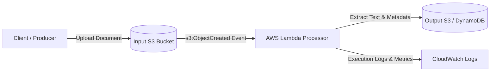

[](https://github.com/saidturan/serverless-doc-processor/actions/workflows/ci.yml)

# Serverless Document Processor

An event-driven microservice to process and analyze uploaded documents in the cloud.

## System Architecture



## Tech Stack & Components
* **Compute:** AWS Lambda (Python 3.12 Runtime)
* **Storage:** Amazon S3 (Raw Documents & Processed Outputs)
* **Infrastructure as Code:** Terraform
* **CI/CD:** GitHub Actions
* **Observability:** Amazon CloudWatch Logs & Metrics

## Getting Started
### Prerequisites
* Python 3.12+
* AWS CLI configured with local credentials
* Terraform >= 1.7.0

### Local Environment Setup
```bash
python3 -m venv venv
source venv/bin/activate
pip install -r src/requirements.txt
```
